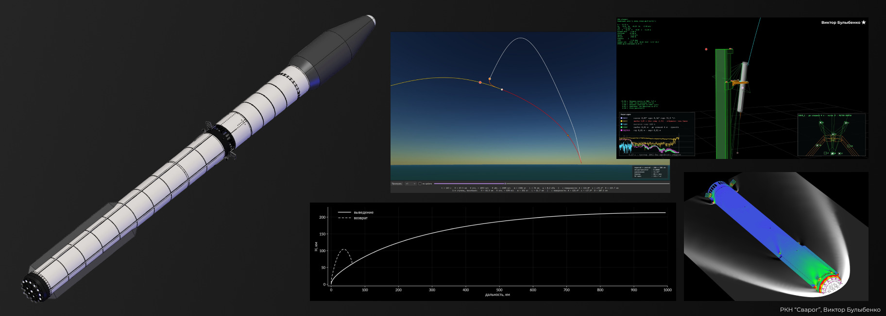
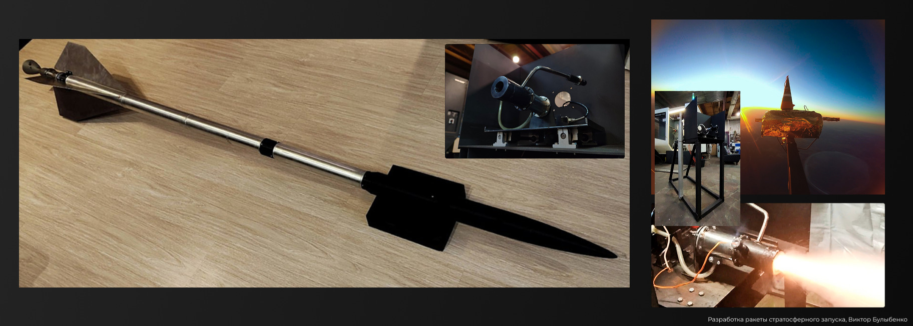
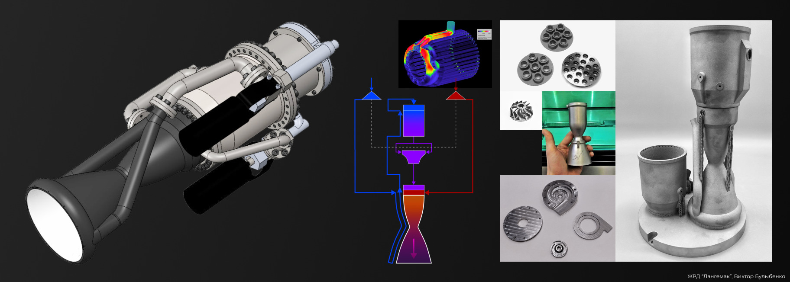
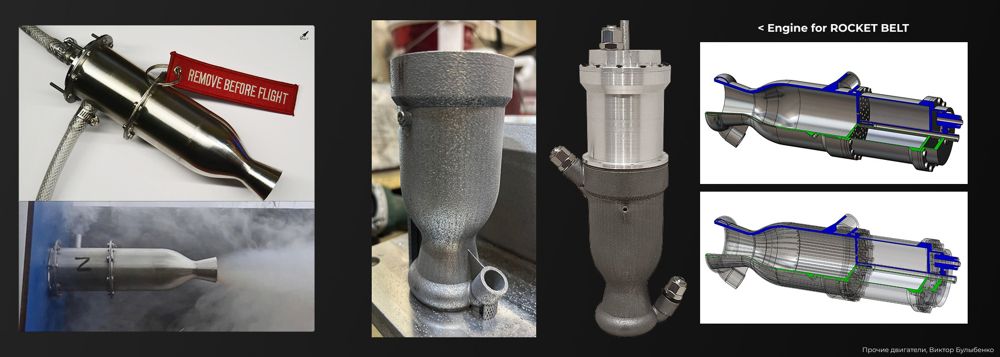
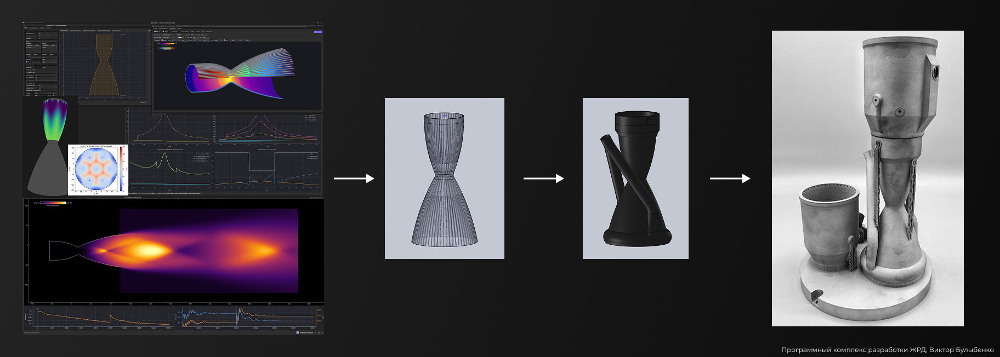
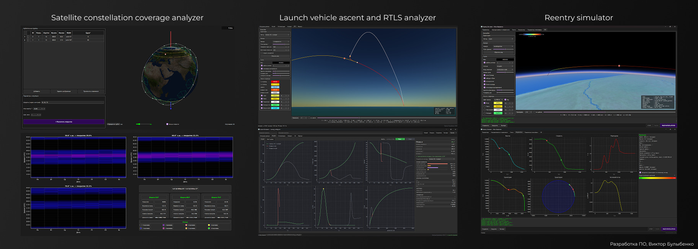
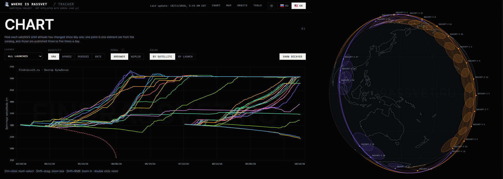

**Viktor Bulybenko** (Виктор Булыбенко) – rocket engineer, founder and chief designer of **RST Space**. Rocket propulsion student at Bauman Moscow State Technical University. Building a small reusable launch vehicle, its engines and the software around them.

## Rockets

### Svarog

Ultralight reusable VTVL launch vehicle. The first stage returns to the launch site and is caught by the tower. Ascent and return trajectories, tower catch simulation and external aerodynamics are computed with in-house tools.

### Stratospheric rocket

Rocket launched from a stratospheric platform at 25 km, climbing to 120 km. PVS-10 engine (10 kgf, 60% hydrogen peroxide and propane): many gas generator, ignition, injector and start-up and shutdown variants tested, hot fire at 50% thrust (2024), full-thrust test programme (2026). Ultra-thin aluminium tanks, long-range digital video and telemetry, inertial and satellite navigation, reaction control system, two-stage parachute system, all in-house. Avionics flight-tested on stratospheric balloon flights since 2023.

## Engines

### Langemak

Family of liquid rocket engines for Svarog: Langemak for the first stage, Langemak-M for the second. Propellants are 90% hydrogen peroxide and butanol. The 400 kgf closed-cycle engine with a turbopump weighs only 1.6 kg, a thrust-to-weight ratio of 250, thanks to a compact layout, high chamber pressure and 3D-printed structures. The gas generator drives the turbine with hot peroxide decomposition products. Chamber, injectors and turbopump parts are 3D-printed from stainless steel, Inconel, titanium and aluminium.

### Other engines

Engines on commercially available 60% hydrogen peroxide. At this concentration the heat of decomposition is not even enough to evaporate all the water, so reliable start-up, ignition and stable operation took years of development. PVS-40 (40 kgf, 2021–2023): extensive monopropellant testing, low-frequency oscillations solved, hot fire at 50% thrust. 50 kgf engine for a rocket belt with a chamber fully 3D-printed from aluminium. Over 60 parts 3D-printed from 9 alloys across all engines.

## Software

### Liquid rocket engine design suite

In-house software for liquid rocket engine design, developed since 2021: performance and nozzle contour with optimization, analytical mixing model, cooling analysis of several types, export of a solid 3D chamber model ready for additive manufacturing. Own CFD solver gives real nozzle losses and real throttling and altitude performance, flow separation included. Used to design the PVS-10 engine (2024) and the Langemak family.

### Mission analysis

In-house mission analysis tools: satellite constellation coverage analyzer, launch vehicle ascent and return-to-launch-site analyzer, reentry simulator, low-thrust orbital maneuver modelling, solar sail mission design, and communication link analysis for satellite constellations.

### findrassvet.ru

Public tracker of Bureau 1440's Rassvet constellation: altitudes, orbit-raising rate, live map and 3D globe. Brouwer mean elements from public NORAD data; [methodology](https://github.com/vbklgd/findrassvet) is published.

---

  
