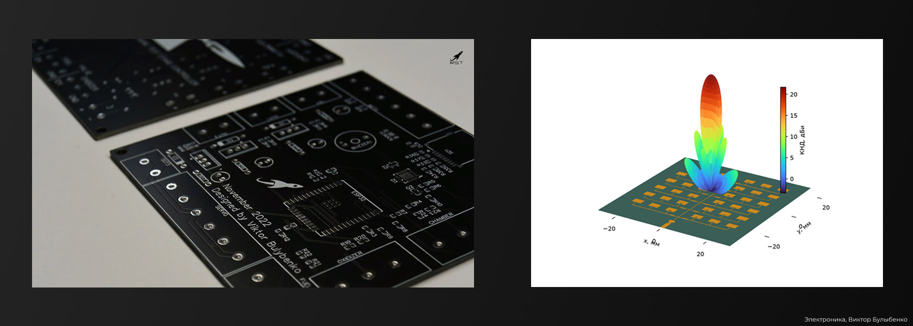
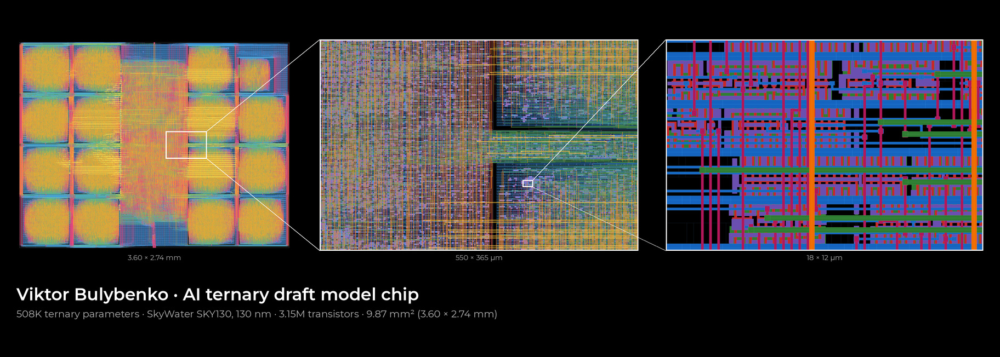

I'm **Viktor Bulybenko** (Виктор Булыбенко), a rocket engineer, founder and chief designer of **RST Space**. I study rocket propulsion at Bauman Moscow State Technical University, department Э1 «Ракетные двигатели» (Rocket Engines). I'm building a small reusable launch vehicle, its engines and the software around them.

## Rockets

### Svarog

Ultralight reusable VTVL launch vehicle: 150 kg to 200 km at 52°, or 100 kg to a 550 km sun-synchronous orbit; 6 t liftoff mass, 13 m tall, 800 mm in diameter. The design combines two ideas: extremely light, thin-walled pressure-stabilized tanks in the tradition of the Atlas (USA) and Blue Streak (UK) rockets of the 1950s–60s, made from 0.5 mm titanium instead of stainless steel, and a Starship-style return with a tower catch. Propellants are 90% hydrogen peroxide and butanol: dense, storable and non-toxic, with no ignition system needed, since butanol ignites on contact with hot decomposed peroxide. The booster carries 21 Langemak engines (8.4 tf at liftoff), and the second stage carries 4 (1.9 tf). After hot staging, the booster flies back to the launch site and is caught by arms on the tower. Reusing it even five times cuts production needs several-fold: far fewer stages, engines and avionics sets to build. The structure is designed to tolerate manufacturing imperfections, so that small deviations do not become critical. Ascent and return trajectories, tower catch simulation and external aerodynamics are computed with in-house tools.

### Stratospheric rocket

Rocket in development, to be launched from a stratospheric platform at 25 km, climb to 120 km and be recovered whole. PVS-10 engine (10 kgf, 60% hydrogen peroxide and propane): many gas generator, ignition, injector and start-up and shutdown variants tested, hot fire at 50% thrust (2024), full-thrust test program (2026). Ultra-thin aluminum tanks, long-range digital video and telemetry, inertial and satellite navigation, reaction control system, two-stage parachute system, all in-house. The rocket has not flown yet; its avionics have been flight-tested on stratospheric balloons since 2023.

## Engines

### Langemak

Family of liquid rocket engines for Svarog: Langemak for the booster, Langemak-M for the second stage. Propellants are 90% hydrogen peroxide and butanol. The 400 kgf engine uses oxidizer-rich staged combustion. A catalytic monopropellant gas generator, needing no ignition system, decomposes the peroxide and drives a single-shaft turbopump at 130,000 rpm (66.8 kW). The hot oxidizer gas then burns with butanol in the chamber at 12 MPa. Handling oxidizer gas at 750 °C and 12–18 MPa required special materials and ceramic coatings. Specific impulse is 259 s, and the engine weighs only 1.6 kg, a thrust-to-weight ratio of 250, thanks to a compact layout, high chamber pressure and 3D-printed structures. About 60% of its parts are 3D-printed from stainless steel, Inconel, titanium and aluminum. It has a wide throttling range, and over 40 parts and several prototype engines have been built and tested.

### Other engines

Engines on commercially available 60% hydrogen peroxide. At this concentration the heat of decomposition is not even enough to evaporate all the water, so reliable start-up, ignition and stable operation took years of development. PVS-40 (40 kgf, 2021–2023) went through extensive monopropellant testing; low-frequency oscillations were solved, and it was hot-fire tested at 50% thrust. 50 kgf engine for a rocket belt with a chamber fully 3D-printed from aluminum. Across all engines, over 60 parts have been 3D-printed from 9 alloys.

## Software

### Liquid rocket engine design suite

In-house software for liquid rocket engine design, developed since 2021: performance and nozzle contour with optimization, analytical mixing model, cooling analysis of several types, export of a solid 3D chamber model ready for additive manufacturing. An in-house CFD solver, written from scratch in Rust, captures actual nozzle losses and actual throttling and altitude performance, including flow separation. Used to design the PVS-10 engine (2024) and the Langemak family.

### Mission analysis

In-house mission analysis tools: satellite constellation coverage analyzer, launch vehicle ascent and return-to-launch-site analyzer, reentry simulator, low-thrust orbital maneuver modeling, solar sail mission design, and communication link analysis for satellite constellations.

## Electronics and RF

Rocket engine test-stand electronics, engine controllers and Svarog avionics, all designed in-house. My current frontier: ARM SoCs (RK3588-class), FPGAs (Gowin series), MCUs (STM32), phased antenna arrays, FMCW radars and advanced communication systems. The main goal is a Pareto-optimal balance of cost and reliability for each specific application.

## Silicon

### AI ternary draft model chip

A ternary (1.58-bit) draft model for speculative decoding of SmolLM2-135M, hardwired into ROM on the open SkyWater SKY130 130 nm process: 508K parameters, 3.15M transistors, 3.60 × 2.74 mm. Taken from training to a fully routed GDS in one day with open-source tools (PyTorch, Yosys, OpenROAD, KLayout); training, integer model and Verilog match bit-for-bit, and the ternary draft reaches 1.66 tokens per target-model pass vs 1.68 for its FP32 counterpart. Layout stage, not yet taped out. A side project I do purely out of my own curiosity.

## Public projects

### findrassvet.ru

Public tracker of Bureau 1440's Rassvet constellation: altitudes, orbit-raising rate, live map and 3D globe. Brouwer mean elements from public NORAD data; [methodology](https://github.com/vbklgd/findrassvet) is published.

## Engineering philosophy: *kutyozh* (кутёж)

Kutyozh (кутёж, Russian for "revelry") is my informal name for how I build: technical rigor combined with a free, lively spirit. Energetic and bold, unafraid of mistakes, always ready to iterate. Engineering should be fun, and the result should still be competitive, reliable and efficient. It lets me adapt fast, save resources and move forward without excessive perfectionism, while keeping technical depth and attention to detail.

---

  
